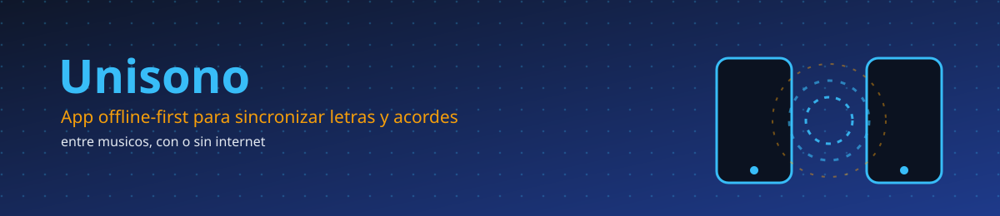
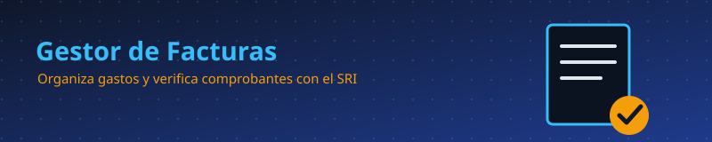
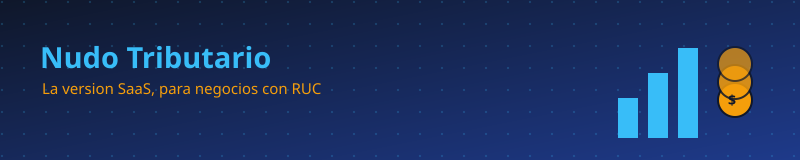
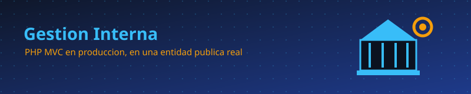

<div align="center">

<picture>
  <source media="(prefers-color-scheme: dark)" srcset="https://readme-typing-svg.demolab.com/?font=Poppins&weight=700&size=38&duration=2500&pause=100000&repeat=false&color=F1F5F9&center=true&vCenter=true&width=500&height=55&lines=David+Alvarado" />
  <source media="(prefers-color-scheme: light)" srcset="https://readme-typing-svg.demolab.com/?font=Poppins&weight=700&size=38&duration=2500&pause=100000&repeat=false&color=0F172A&center=true&vCenter=true&width=500&height=55&lines=David+Alvarado" />
  
</picture>


<br/>

<a href="https://linkedin.com/in/david-alvarado-ronquillo"></a>
<a href="https://portafolio-hwaq.vercel.app/en"></a>
<a href="mailto:lui.alv.ron.25@gmail.com"></a>

</div>

### 🐧 whoami

```ansi
david@portfolio
---------------
    .--.        OS       Desarrollador Full Stack Senior · DevOps · Seguridad
   |o_o |       Host     Áslam IT (España) — 100% remoto
   |:_/ |       Kernel   Vue 3 · Nuxt · .NET · TypeScript · SQL Server
  //   \ \      Uptime   3+ años construyendo software en producción
 (|     | )     Packages Ing. en Sistemas + Máster en Ciberseguridad (OBS, Madrid)
/'\_   _/`\     Shell    OWASP Top 10 · JWT · OAuth 2.0 · Hardening Linux
\___)=(___/     Idiomas  Español (nativo) · Inglés (técnico)
                Contact  linkedin.com/in/david-alvarado-ronquillo
```


<br>

<div align="center">

<picture>
  <source media="(prefers-color-scheme: dark)" srcset="https://raw.githubusercontent.com/Lualvarad0/Lualvarad0/output/github-contribution-grid-snake-dark.svg" />
  <source media="(prefers-color-scheme: light)" srcset="https://raw.githubusercontent.com/Lualvarad0/Lualvarad0/output/github-contribution-grid-snake.svg" />
  
</picture>

</div>

<br>

### 🚀 Proyectos destacados

<p><code>$ tree ~/proyectos-destacados -L 1</code></p>

<a href="https://github.com/Lualvarad0/Unisono">

</a>

<table>
<tr>
<td width="60%" valign="top">


</td>
<td width="40%" valign="top" align="center">


</td>
</tr>
</table>

**Proyecto insignia.** App offline-first para equipos de alabanza: letra, acordes y tonalidad sincronizados en tiempo real entre celulares, con o sin internet local. Pensada para ensayos y cultos donde la señal es el último problema que deberías tener.

<code>Flutter</code> <code>Firebase</code> <code>Nearby Connections</code>

→ [Ver el código](https://github.com/Lualvarad0/Unisono)

<br>

<table>
<tr>

<td width="33%" valign="top">




<p align="center"></p>

Organiza gastos en Ecuador: importa facturas XML, verifica comprobantes con el SRI y clasifica todo por categoría, automáticamente.

<code>Angular</code> <code>.NET</code> <code>PostgreSQL</code>

→ [Código](https://github.com/Lualvarad0/Gestor-Facturas-sri)

</td>
<td width="33%" valign="top">




<p align="center"></p>

La versión SaaS para negocios con RUC: comprobantes del SRI, deducciones y control tributario sin adivinanzas.

<code>C#</code> <code>.NET</code> <code>SaaS</code>

→ [Código](https://github.com/Lualvarad0/Nudo-Gestion-Financiera-Tributaria)

</td>
<td width="33%" valign="top">




<p align="center"></p>

PHP MVC en producción real: colegios, luminarias CNEL, trabajadores, roles y notificaciones. No es una demo.

<code>PHP</code> <code>MySQL</code> <code>MVC</code>

→ [Código](https://github.com/Lualvarad0/Sistema-Gestion-Interna)

</td>

</tr>
</table>

<br>

### 🧠 Tech Stack

<div align="center">

<br/>


</div>

<p align="center"><sub><b>Seguridad</b> &nbsp;·&nbsp; OWASP Top 10 &nbsp;·&nbsp; Burp Suite &nbsp;·&nbsp; Nmap</sub></p>

<br><br>


